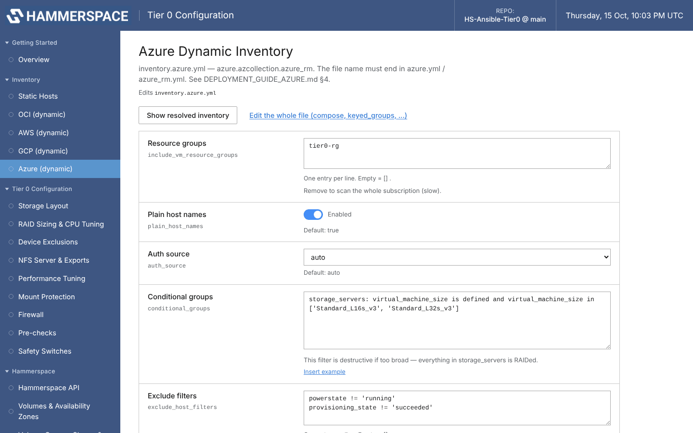
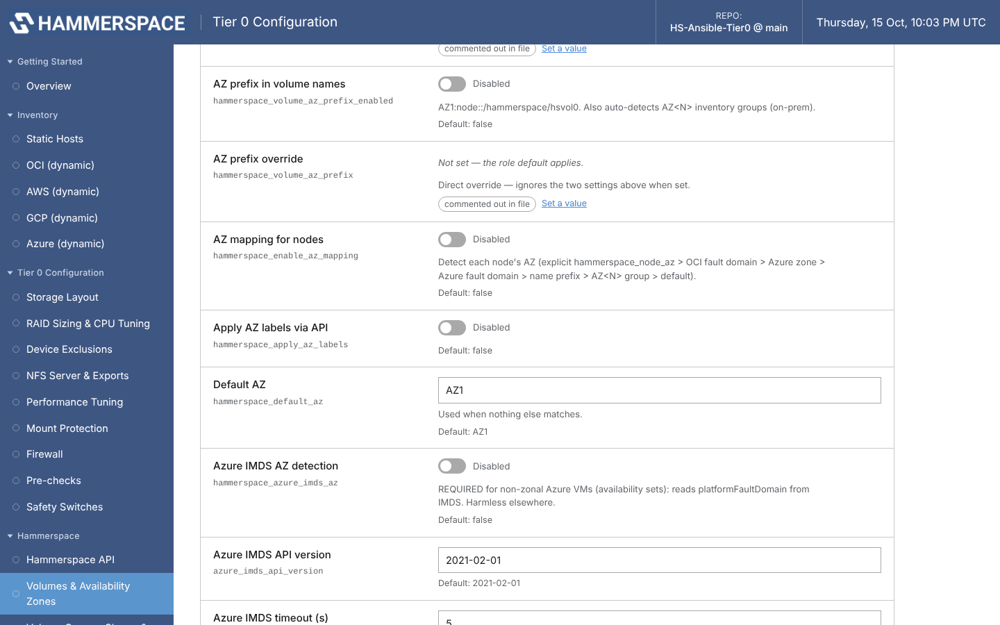

# Microsoft Azure — GUI Guide

For Tier 0 on Azure VMs with local NVMe (Lsv3/Lasv3, ND/NC GPU, HB/HC HPC sizes)
or attached managed disks, discovered through the `azure.azcollection.azure_rm`
dynamic inventory. The command-line equivalents are the
[manual (CLI) Azure inventory](../manual/inventory-azure.md) and the end-to-end
[DEPLOYMENT_GUIDE_AZURE.md](../../DEPLOYMENT_GUIDE_AZURE.md), which also covers SKU
sizing, Accelerated Networking and NSGs in depth. Using filesystems you already
built? See [DEPLOYMENT_GUIDE_AZURE_EXISTING_MOUNT.md](../../DEPLOYMENT_GUIDE_AZURE_EXISTING_MOUNT.md).

| Step | Where |
|------|-------|
| 1. Prepare the controller + Azure access | terminal (once) |
| 2. Start the GUI | terminal |
| 3. Select your VMs | **Inventory → Azure (dynamic)** |
| 4. Match the disk layout | **Tier 0 Configuration → Storage Layout** |
| 5. AZ mapping | **Hammerspace → Volumes & Availability Zones** |
| 6. Configure and deploy | [shared GUI steps](configure-and-deploy.md) |

## 1. Prepare the controller and Azure access

```bash
pip3 install ansible
git clone https://github.com/vjason1/HS-Ansible-Tier0.git
cd HS-Ansible-Tier0
git lfs pull                                   # DI RPMs, only if you deploy DI
ansible-galaxy collection install -r requirements.yml   # includes azure.azcollection (<2.6 for ansible-core 2.14)
pip3 install -r ~/.ansible/collections/ansible_collections/azure/azcollection/requirements.txt

# Credentials — pick one
az login && az account set --subscription <subscription-id>      # interactive
# service principal: export AZURE_SUBSCRIPTION_ID=... AZURE_CLIENT_ID=... AZURE_SECRET=... AZURE_TENANT=...
# managed identity on an Azure controller (CycleCloud scheduler): auth source "msi" in step 3

# Find the resource group that holds the Tier 0 VMs
az vm list --query "[].{name:name, rg:resourceGroup, size:hardwareProfile.vmSize}" -o table
```

Start the GUI from the same shell so it inherits any `AZURE_*` variables.

## 2. Start the GUI

```bash
python3 gui/tier0_gui.py
```

Open the printed URL (headless controller: `ssh -L 8765:127.0.0.1:8765 <user>@<controller>` first).

## 3. Select your VMs — Inventory → Azure (dynamic)

This menu edits `inventory.azure.yml`. The plugin only recognises files ending in
`azure.yml` / `azure_rm.yml` — don't rename it.



| Field | What to set |
|-------|-------------|
| **Resource groups** | The group(s) holding the Tier 0 VMs. Removing it scans the whole subscription (slow). |
| **Plain host names** | On — bare VM names as host names |
| **Auth source** | `auto`; `msi` on a controller with a managed identity |
| **Conditional groups** | The `storage_servers` filter. **It is destructive if too broad: every VM it matches gets its disks RAIDed and formatted.** Select by exact size, size family or tag, e.g. `virtual_machine_size is defined and virtual_machine_size in ['Standard_L16s_v3', 'Standard_L32s_v3']` |
| **Strict (debug group expressions)** | Turn on temporarily if a filter matches nothing — errors in these expressions are silent otherwise |
| **Cache / Cache timeout** | Inventory caching (default 300 s) |

**Save to file**, then **Show resolved inventory** and confirm that exactly the
intended VMs are in `storage_servers`.

**Scale sets (VMSS / CycleCloud execute nodes)** aren't fetched by default — open
**Edit the whole file** and add `include_vmss_resource_groups: ['*']` (or specific
groups). The same editor reaches `hostvar_expressions` (connection address and the
`azure_*` placement variables); add `ansible_user: "'azureuser'"` there if your
image's user differs from the controller user.

SSH: make the VMs' key available to the controller (`~/.ssh/config`, `ssh-add`, or
**Controller → Ansible Settings → SSH private key**), or use
[Copy SSH key to hosts](static.md#4-give-ansible-ssh-access--copy-ssh-key-to-hosts)
for password-only images. Azure reuses private IPs for reimaged VMs; this repo's
`ansible.cfg` therefore doesn't pin host keys.

## 4. Match the disk layout — Storage Layout


| VM family | Local storage | **Storage device type** |
|-----------|---------------|-------------------------|
| Lsv3 / Lasv3 / Lsv2 (storage optimized) | Local NVMe | `nvme` |
| ND / NC (GPU) | Local NVMe | `nvme` |
| Any + attached Premium SSD v2 / Ultra Disk | Managed disks as `/dev/sd*` | `scsi` (Azure reports `rotational=1` even for SSD, so `ssd` can drop every data disk) |

Azure specifics handled for you, worth knowing:

- **The ephemeral resource disk** (usually `/dev/sdb`, mounted at `/mnt`) is wiped on
  deallocate and is never used: `/mnt` and `/mnt/resource` are protected system
  mountpoints. Confirm with a dry run (tags `discovery`) — the "Disk classification"
  output lists it as protected.
- **NVMe pre-mounted as scratch** (HB/HC sizes, CycleCloud mounts it at `/tmp` and
  `/nvme`): discovery reports *0 RAID arrays* because the disk is in use. Set
  **Release cloud scratch mounts** to `/tmp` and `/nvme` — it unmounts them and drops
  their fstab entries before discovery. `/tmp` is usually busy: run once, reboot the
  node, run again. Disks that also back `/`, `/boot`, `/usr`, `/var`, `/etc`, `/home`
  or swap are always refused.
- **A single local NVMe** (e.g. HB120rs_v3): nothing to stripe — turn off *Use software
  RAID* and list `/dev/nvme0n1` under *Hardware RAID devices*.

## 5. AZ mapping — Volumes & Availability Zones



| VM placement | Settings | Result |
|--------------|----------|--------|
| **Availability zones** (zonal VMs) | *AZ mapping for nodes* on (+ *AZ prefix in volume names*, *Apply AZ labels via API* as wanted) | zone `1` → `AZ1` — the inventory provides it |
| **Availability sets** (non-zonal) | the above **plus *Azure IMDS AZ detection* on** | `platformFaultDomain` read from each VM (0-based, so `0` → `AZ1`) |

Zone wins when both exist. *Default AZ* applies when nothing is detected, and a
per-host `hammerspace_node_az` (Static Hosts / host variables) overrides everything.
IMDS detection is harmless to leave on for non-Azure hosts.

## 6. Configure and deploy

Continue with the [shared GUI steps](configure-and-deploy.md). Azure specifics:

- **The first time, on the Run page, untick `inventory.yml` and tick `inventory.azure.yml`.**
  The app remembers that choice for every later run and for OS Upgrade Check.
- Password from Key Vault instead of the vault file: **Hammerspace API → Azure Key Vault
  URI** + *secret name* + *auth source* (`msi` on CycleCloud). The controller's identity
  needs *Key Vault Secrets User*.
- NSGs must allow SSH from the controller, NFS between the VMs and the Hammerspace
  cluster (111, 2049, 20048 TCP/UDP; 20049 TCP for RDMA), and access to the Anvil
  management IP on port 8443 for the API integration.
- Adding VMs later: **Preflight: find new instances**, then deploy with *Limit*
  `@.new_instances_limit`.

## Related

- [DEPLOYMENT_GUIDE_AZURE.md](../../DEPLOYMENT_GUIDE_AZURE.md) (Azure end to end) · [Existing-mount mode on Azure](../../DEPLOYMENT_GUIDE_AZURE_EXISTING_MOUNT.md)
- [Manual (CLI) Azure inventory](../manual/inventory-azure.md) · [GUI reference](../../gui/README.md)
- [OS Upgrade Configuration Check](../os-upgrade-check.md) · [Rack operations runbook](../../RACK_OPERATIONS_RUNBOOK.md)
