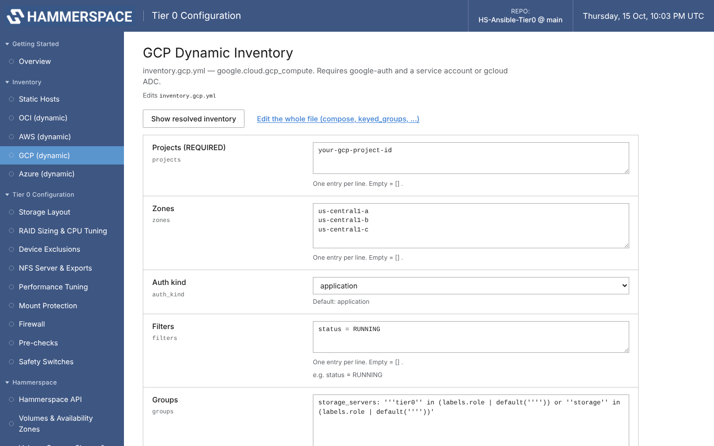

# Google Cloud (GCP) Compute Engine — GUI Guide

For Tier 0 on Compute Engine instances with local SSD/NVMe, discovered through the
`google.cloud.gcp_compute` dynamic inventory. The
[manual (CLI) version](../manual/inventory-gcp.md) covers the same setup by editing
`inventory.gcp.yml` by hand; for the rest of a cloud deployment from the command
line, GCP follows the [OCI deployment guide](../../DEPLOYMENT_GUIDE.md) from section 5.

| Step | Where |
|------|-------|
| 1. Prepare the controller + GCP access | terminal (once) |
| 2. Start the GUI | terminal |
| 3. Select your instances | **Inventory → GCP (dynamic)** |
| 4. SSH access | your instance key on the controller |
| 5. Configure and deploy | [shared GUI steps](configure-and-deploy.md) |

## 1. Prepare the controller and GCP access

```bash
pip3 install ansible google-auth requests
git clone https://github.com/vjason1/HS-Ansible-Tier0.git
cd HS-Ansible-Tier0
git lfs pull                                   # DI RPMs, only if you deploy DI
ansible-galaxy collection install -r requirements.yml   # includes google.cloud

# Credentials — pick one
export GOOGLE_APPLICATION_CREDENTIALS=/path/to/service-account.json   # automation
gcloud auth application-default login                                  # interactive
# or: run the controller on GCE with its service account
```

Start the GUI from the same shell so it inherits `GOOGLE_APPLICATION_CREDENTIALS`.

## 2. Start the GUI

```bash
python3 gui/tier0_gui.py
```

## 3. Select your instances — Inventory → GCP (dynamic)

This menu edits `inventory.gcp.yml`.



| Field | What to set |
|-------|-------------|
| **Projects (REQUIRED)** | Your project ID — the inventory returns nothing without it |
| **Zones** | e.g. `us-central1-a`, `us-central1-b`, `us-central1-c` |
| **Auth kind** | `application` (ADC / `GOOGLE_APPLICATION_CREDENTIALS`), `serviceaccount`, or `machineaccount` |
| **Filters** | e.g. `status = RUNNING`, `labels.role = storage` |
| **Groups** | The `storage_servers` expression — **everything it matches gets its local drives RAIDed**, e.g. `storage_servers: "'tier0' in (labels.role \| default(''))"` |

`compose:` (`ansible_host: networkInterfaces[0].networkIP`, `ansible_user`, the AZ
prefix) is reached with **Edit the whole file**.

**Save to file**, then **Show resolved inventory**. Hosts carry `gcp_instance_name`,
`gcp_machine_type`, `gcp_zone`, `gcp_region`, `gcp_private_ip`.

## 4. SSH access

Make the key you use for the instances available on the controller (`~/.ssh/config`,
`ssh-add`, or **Controller → Ansible Settings → SSH private key**). For hosts reachable
only with a password, see
[Copy SSH key to hosts](static.md#4-give-ansible-ssh-access--copy-ssh-key-to-hosts).

## 5. Availability zones

`compose:` maps the zone letter to the Hammerspace AZ prefix:

| GCP zone | Hammerspace AZ prefix |
|----------|-----------------------|
| us-central1-a | `AZ1:` |
| us-central1-b | `AZ2:` |
| us-central1-c | `AZ3:` |

For node AZ labels also turn on **Volumes & Availability Zones → AZ mapping for
nodes** and *Apply AZ labels via API*.

## 6. Configure and deploy

Continue with the [shared GUI steps](configure-and-deploy.md). GCP specifics:

- **The first time, on the Run page, untick `inventory.yml` and tick `inventory.gcp.yml`.**
  The app remembers that choice for every later run and for OS Upgrade Check.
- Firewall rules must allow SSH from the controller, NFS between the nodes and the
  Hammerspace cluster (111, 2049, 20048 TCP/UDP; 20049 TCP for RDMA), and access to
  the Anvil management IP on port 8443 for the API integration.

## Related

- [Manual (CLI) GCP inventory](../manual/inventory-gcp.md) · [GUI reference](../../gui/README.md)
- [OS Upgrade Configuration Check](../os-upgrade-check.md) · [Rack operations runbook](../../RACK_OPERATIONS_RUNBOOK.md)
