# Tier 0 Configuration GUI

A local web interface for configuring and operating this repository. It edits
the same files you would edit by hand — `vars/main.yml`, `vars/vault.yml`,
`ansible.cfg`, `inventory*.yml` — and runs the same playbooks and scripts, so
everything it does stays visible in Git and repeatable from a terminal.

It is styled to match the Hammerspace management UI — the same navy header
and navigation rail, logo, and health-indicator colors. Each menu's status dot
uses those colors: yellow for unsaved edits, red for a configuration error,
green (blinking) on Job History while a job runs.

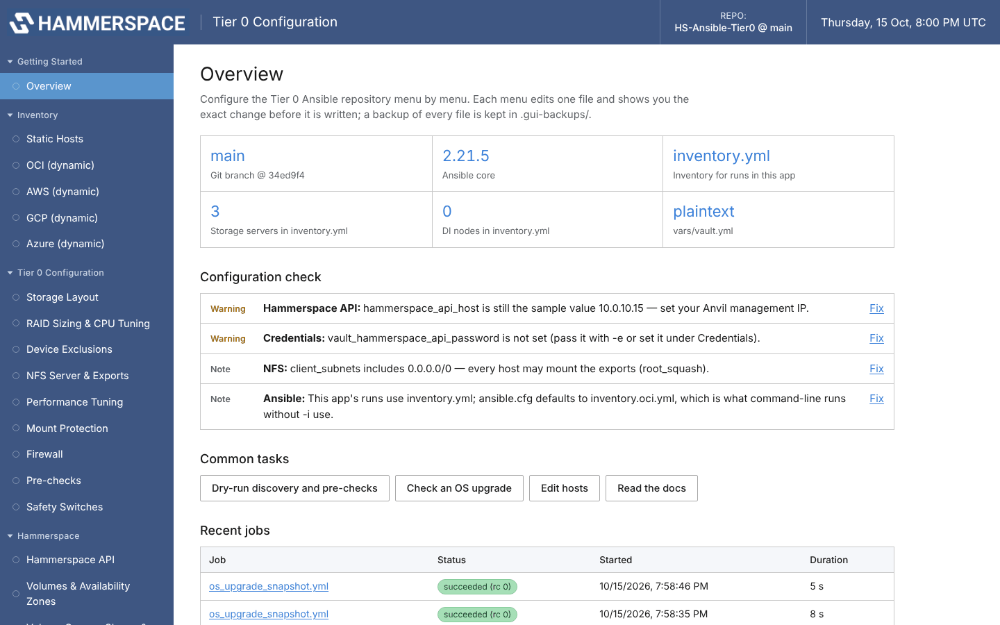

Screenshots in this guide use three example storage servers (node101–node103) and an example
Rocky Linux 9.5 → 9.6 upgrade.

- [Starting it](#starting-it)
- [Menus and the files they edit](#menus-and-the-files-they-edit)
- [How saving works](#how-saving-works)
- [Credentials and Ansible Vault](#credentials-and-ansible-vault)
- [Static host inventory](#static-host-inventory)
- [Copying the controller's SSH key to hosts](#copying-the-controllers-ssh-key-to-hosts)
- [Running playbooks and tools](#running-playbooks-and-tools)
- [OS Upgrade Check](#os-upgrade-check)
- [Logs & Reports](#logs--reports)
- [Security model](#security-model)
- [Troubleshooting](#troubleshooting)
- [Adding a variable to the GUI](#adding-a-variable-to-the-gui)

## Starting it

Run it on the Ansible controller, from the repository:

```bash
python3 gui/tier0_gui.py
```

```
Tier 0 Configuration GUI 1.0.0
  repository : /home/ubuntu/HS-Ansible-Tier0
  open       : http://127.0.0.1:8765/#token=Jx3...
  remote use : ssh -L 8765:127.0.0.1:8765 <user>@controller   then open the URL above
  stop       : Ctrl-C
```

Open the printed URL (including `#token=...`). On a headless controller or
bastion, forward the port from your workstation and open the same URL there:

```bash
ssh -L 8765:127.0.0.1:8765 ubuntu@controller
```

| Option | Default | Purpose |
|--------|---------|---------|
| `--port N` | `8765` (or `$TIER0_GUI_PORT`) | Listen port |
| `--host ADDR` | `127.0.0.1` | Bind address. Anything other than localhost prints a warning — prefer the SSH tunnel |
| `--token T` | random per start (or `$TIER0_GUI_TOKEN`) | Fixed access token, e.g. for a bookmarked URL |
| `--read-only` | off | Browse, validate and build commands, but no saves and no runs |
| `--repo PATH` | parent of `gui/` | Repository to manage |
| `--no-browser` | off | Don't try to open a local browser |
| `--verbose` | off | Log every HTTP request |

**Requirements:** Python 3.6+ and PyYAML. PyYAML is installed with Ansible,
so there is nothing extra to install. The page uses no CDN, web fonts or other
external assets, so it works unchanged on air-gapped / dark-site controllers.
Running playbooks needs `ansible-playbook` on `PATH`; the Credentials menu
needs `ansible-vault` for encrypted vaults.

## Menus and the files they edit

Each menu edits exactly one file. The file is named under the page title.


The sidebar groups (Inventory, Tier 0 Configuration, Hammerspace, ...)
collapse and expand with a click on their heading; **Collapse all** /
**Expand all** sit at the bottom. The open/closed state is remembered in the
browser, the group holding the page you open is always expanded, and a
collapsed group shows its menu count plus the most urgent status dot of its
menus, so unsaved edits or errors are never hidden.

| Group | Menu | File | Covers |
|-------|------|------|--------|
| Getting Started | Overview | — | Git branch, Ansible version, default inventory, vault state, host counts, configuration check, recent jobs |
| Inventory | Static Hosts | `inventory.yml` / `inventory.az.yml` | Groups (`storage_servers`, `di_nodes`, `nfs_clients`, `di_k8s_build_hosts`, custom), AZ subgroups, hosts, host and group variables; **Copy SSH key to hosts** |
| | OCI / AWS / GCP / Azure | `inventory.<cloud>.yml` | Regions/projects/zones/resource groups, filters, the `storage_servers` group expression |
| Tier 0 Configuration | Storage Layout | `vars/main.yml` | Discovery vs. manual RAID vs. HW RAID vs. existing-mount mode, `storage_type`, mount base, `xfs_agcount`, ephemeral-mount release |
| | RAID Sizing & CPU Tuning | `vars/main.yml` | RAID level, grouping strategy, max/min drives, power-of-2, leftovers, CPU profile overrides, sync waits |
| | Device Exclusions | `vars/main.yml` | All `nvme_exclude_*` and `scsi_exclude_*` lists |
| | NFS Server & Exports | `vars/main.yml` | nfsd threads, NFS versions, RDMA, Hammerspace/mover/client lists, export options |
| | Performance Tuning | `vars/main.yml` | sunrpc slots, nfsd block size + direct I/O, read-ahead, IRQ pinning, TCP sysctl |
| | Mount Protection | `vars/main.yml` | Guard services, remount watchdog |
| | Firewall | `vars/main.yml` | Firewall on/off, iptables flush, NFS ports, firewalld services |
| | Pre-checks | `vars/main.yml` | Drive counts, sector size, MTU, jumbo-frame targets, iperf, packages |
| | Safety Switches | `vars/main.yml` | `force_raid_recreate`, `force_fs_recreate`, 4K format, empty-protected-disk override |
| Hammerspace | Hammerspace API | `vars/main.yml` | Anvil host, user, password reference, TLS, HTTP method, node name/IP, Azure Key Vault |
| | Volumes & Availability Zones | `vars/main.yml` | Thresholds, protection, availability/durability, AZ prefix modes, AZ mapping, Azure IMDS, GPU fabric |
| | Volume Groups, Shares & Objectives | `vars/main.yml` | Join existing group, create groups, shares, share objectives |
| | API Throttling & Timeouts | `vars/main.yml` | `hammerspace_serial`, task-queue throttling, poll retries/timeouts |
| | Cluster Settings | `vars/main.yml` | DNS, Active Directory, site name, location, Prometheus |
| | S3 / Object Storage | `vars/main.yml` | S3 nodes, object volumes, S3 server, S3 users |
| Data Instantiator | Deployment / Packages / Node, AZ & Host / Kubernetes / Decommission | `vars/main.yml` | Every `di_*` variable, grouped by task |
| Controller | Credentials | `vars/vault.yml` | `vault_*` secrets, with encrypt / unlock |
| | Ansible Settings | `ansible.cfg` | Default inventory, SSH key, forks, become, pipelining |
| | Raw File Editor | any allow-listed file | Full-text editing with YAML/INI validation |
| Operate | Run Playbooks | — | Command builder + live output for every playbook |
| | Hammerspace Utilities | — | Forms for the `*.py` cluster tools |
| | OS Upgrade Check | `snapshots/` | Guided pre/post snapshot and diff reports |
| | Job History | `logs/gui-jobs/` | Every GUI run with its full output |
| | Logs & Reports | `logs/`, `snapshots/`, reports | Every Ansible log, GUI job, report and audit entry; view, download, retention, upload to Hammerspace |
| Reference | Documentation | — | This repository's Markdown guides, rendered offline |

Every field shows its variable name, the documented default and the help
text from [VARIABLE_REFERENCE.md](../VARIABLE_REFERENCE.md) and the
`vars/main.yml` comments. Fields that only apply in a certain mode are hidden
until that mode is selected (for example the container settings only appear
when `di_deployment_type` is `container`).

A field's state is shown under it:

- **not in file — default shown**: the key isn't in the file; the role default
  applies. Editing it adds the key.
- **commented out in file**: there is a `# key: value` example. *Set a value*
  activates it directly under the example.
- *Unset (use default)* comments a key back out instead of deleting it.

## How saving works

`vars/main.yml` is ~1,300 lines whose comments are the documentation, so the
GUI never rewrites the whole file.

1. **Edit** fields on any number of menus. The menu's status dot turns yellow; edits
   survive switching menus.
2. **Review changes** shows the exact unified diff of the file.
3. **Save to file**:
   - only the lines that hold the changed keys are rewritten; every other line
     — comments, blank lines, quoting of untouched values — stays byte-identical
     (a scalar edit even keeps its inline `# comment`);
   - the result is parsed again and must read back with the intended values,
     with **no other key changed**, or nothing is written;
   - the previous version is copied to `.gui-backups/<file>.<timestamp>`
     (the newest 30 per file are kept);
   - if someone changed the file on disk since you loaded it (an editor, a
     `git pull`), the save is refused with a conflict and you reload.

New values are written in plain YAML: strings are always quoted, so values
like `yes`, `0755` or `1e3` can't be misread as booleans or numbers.

## Credentials and Ansible Vault

`vars/vault.yml` holds `vault_hammerspace_api_password` and the other
secrets that `vars/main.yml` references as `{{ vault_... }}`.

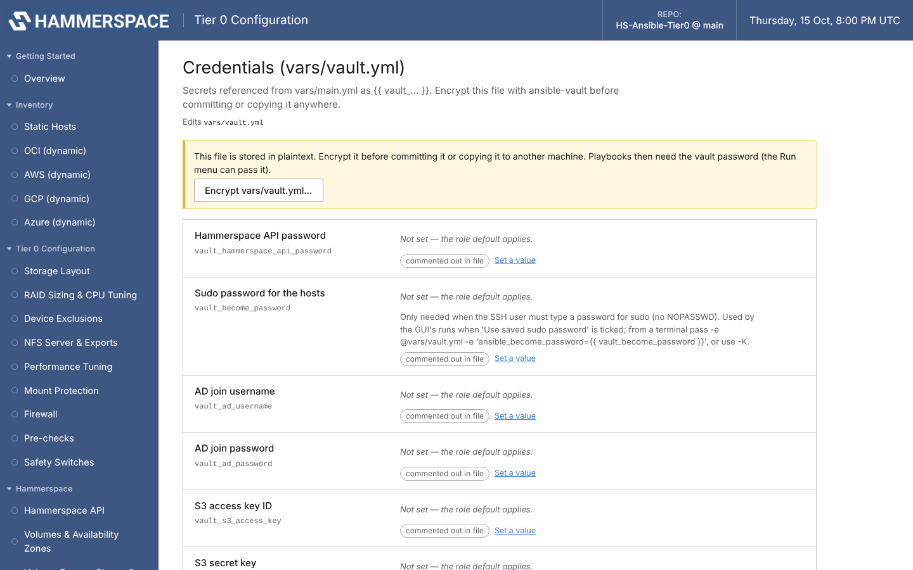

- **Plaintext vault:** the page warns and offers **Encrypt vars/vault.yml**.
  After encryption the plaintext backup is deleted, so the secret doesn't
  linger in `.gui-backups/`.
- **Encrypted vault:** enter the vault password to unlock. It is kept only in
  the browser tab's memory, sent with each save so the server can decrypt,
  apply the change and re-encrypt with the same password. Nothing plaintext is
  written to disk. Secret values are masked in the change preview.
- The Run pages reuse the unlocked password automatically (passed to
  `ansible-playbook` through a 0600 temporary file that is deleted when the
  job ends), or accept a vault password file.

### Sudo (become) password for the hosts

The playbooks run with `become` (sudo). If the SSH user has passwordless sudo
(`NOPASSWD`, the default on most cloud images) there is nothing to set. If sudo
asks for a password, a run fails with *Missing sudo password*. Give it in one
of two places:

| Where | When to use | How it reaches Ansible |
|-------|-------------|------------------------|
| **Run Playbooks / OS Upgrade Check → Sudo password on the hosts** | One-off, or you don't want it stored | 0600 temporary extra-vars file (`-e @file`), deleted when the job ends — the same as `ansible-playbook -K` |
| **Credentials → Sudo password for the hosts** (`vault_become_password`) + tick **Use the saved sudo password** on the run page | Every run, kept encrypted with your other secrets | `-e @vars/vault.yml -e '{"ansible_become_password": "{{ vault_become_password }}"}'` (the vault password is needed if the vault is encrypted) |

If both are given, the typed one wins. Why not just put it in the vault and be
done: the plays gather facts — which already needs sudo — *before* their
`pre_tasks` load `vars/vault.yml`, so the password has to arrive as extra vars.
The command preview on the Run page shows exactly what is passed (never the
password itself).

From a terminal the equivalents are `-K` (prompt), or
`-e @vars/vault.yml -e 'ansible_become_password={{ vault_become_password }}'`
(add `--ask-vault-pass` / `--vault-password-file` for an encrypted vault).
Different sudo passwords per host can be set as `ansible_become_password` host
variables in the inventory (better as vault references than plaintext).

## Static host inventory

The **Static Hosts** menu edits `inventory.yml` (or the AZ-grouped sample
`inventory.az.yml`) as a tree: groups → optional AZ subgroups → hosts, with
`ansible_host` as its own column and other variables as `key=value` lines
(`true`/`false` and integers are typed automatically).

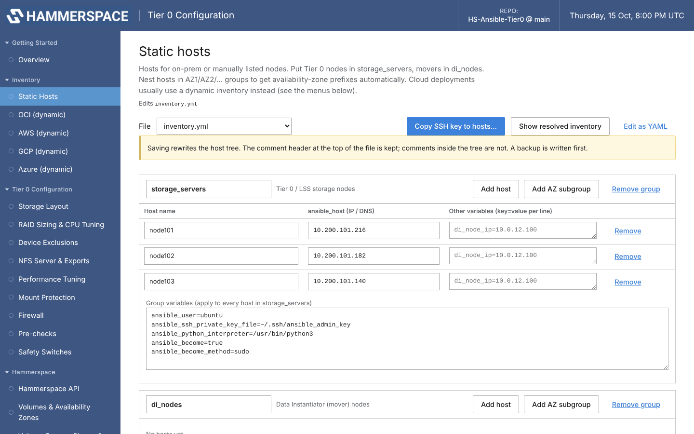

Nesting hosts under `AZ1`, `AZ2`, ... subgroups is how on-prem deployments get
AZ prefixes (`hammerspace_volume_az_prefix_enabled: true`), and how DI nodes
are spread across zones.

Saving rewrites the host tree: the comment header at the top of the file is
kept, comments *inside* the tree are not (a backup is written first). Files
with deeper nesting than group → subgroup are detected and the page sends you
to the raw editor instead of risking data loss.

**Show resolved inventory** runs `ansible-inventory --graph --vars` for the
file, which is the quickest way to confirm what a cloud inventory will select
before anything gets RAIDed.

## Copying the controller's SSH key to hosts

For hosts where key-based SSH was never set up — and where you don't want to
copy a private key file onto the controller — **Static Hosts → Copy SSH key to
hosts…** authorizes this controller's own key on them:

1. Enter the **SSH user** and **password** to log in with. The user is
   prefilled with the inventory's `ansible_user` when all hosts share one;
   whatever you enter is the account the key is installed for.
2. Pick the controller's public key (keys in `~/.ssh` of the user running the
   GUI, with fingerprints), or **Generate a new ed25519 key pair** if there is
   none (`~/.ssh/id_ed25519`, or `id_ed25519_tier0` if that name is taken —
   an existing key is never overwritten).
3. Choose the hosts (all remote hosts of the file are listed with the address,
   port and inventory user Ansible would use; `ansible_connection: local`
   hosts are skipped).
4. **Copy key** runs [`scripts/push_ssh_key.py`](../scripts/push_ssh_key.py)
   as a job. For each host it logs in once with the password, appends the
   public key to `~/.ssh/authorized_keys` only if that exact line is not
   already there (creating `~/.ssh` 0700 / `authorized_keys` 0600, restoring
   SELinux labels), then logs in again **with the key only** to prove it works.

With **Write ansible_user and ansible_ssh_private_key_file into the inventory**
on (the default), the inventory editor is updated for the selected hosts — on
the group when the whole group was selected, otherwise per host — and the
Static Hosts menu turns yellow. Review the diff and **Save to file**; Ansible
then connects with the controller's private key, which never leaves it.

Notes:

- The password is sent to the GUI server once, handed to `ssh` through an
  environment variable read by a throwaway `SSH_ASKPASS` helper, and never
  placed on a command line, written to disk or logged. `sshpass` is not needed.
- The hosts must allow password logins for that user (`PasswordAuthentication
  yes`; for `root`, `PermitRootLogin yes`). The job log names the reason for
  every failure (wrong password, password logins disabled, host key changed,
  unreachable, connection refused).
- Unknown host keys are accepted and recorded in `~/.ssh/known_hosts`; a host
  whose key **changed** is refused, because sending it a password could hand
  the password to an impostor. For reimaged nodes that reuse IPs, run
  `ssh-keygen -R <ip>` or tick **Don't check host keys**.
- Same thing from a terminal:
  ```bash
  read -rs TIER0_SSH_PASSWORD && export TIER0_SSH_PASSWORD
  python3 scripts/push_ssh_key.py --user ubuntu --pubkey ~/.ssh/id_ed25519.pub \
      --target node101=10.200.101.216 --target node102=10.200.101.182:2222
  ```

## Running playbooks and tools

**Run Playbooks** builds an `./scripts/run.sh playbook ...` command (so the
UTF-8 locale fix and per-run logging apply) from:

- playbook (every playbook in the repo, with a description),
- inventory files (`-i`). Your last selection is remembered (see below); the
  first time, `inventory.yml` is ticked, or `ansible.cfg`'s default if there is
  no `inventory.yml`. `--limit`,
- tags and skip-tags as checkboxes (only tags that exist in the playbooks),
- Check mode (**on by default**), `--diff`, verbosity,
- vault password and sudo password (see
  [Sudo (become) password](#sudo-become-password-for-the-hosts)),
- playbook-specific extras (`deploy_di`, `hammerspace_serial`,
  `reset_confirm`, `decommission_confirm`, ...) and free-form `key=value` extra vars.


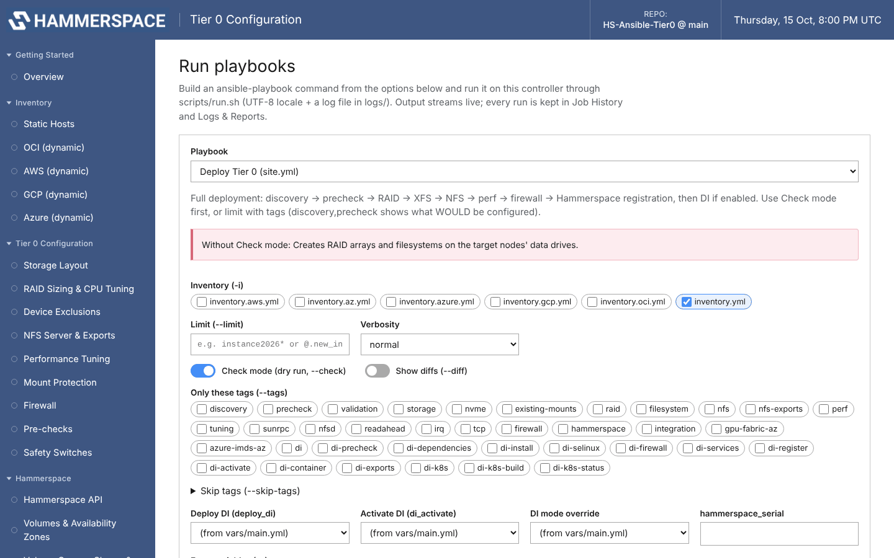

The exact command is shown before you run it.

**Remembered inventory.** Whatever inventory files you tick on Run Playbooks or
OS Upgrade Check are saved immediately and preselected on both pages from then
on. The choice is stored on the controller in `.gui-state.json` (gitignored),
not in the browser, so it also applies from another browser or machine. A
remembered file that no longer exists is dropped. The Overview shows the
inventory runs will use and notes when it differs from `ansible.cfg`, which
command-line runs without `-i` still use. A run that can destroy data —
`site.yml` without Check mode, `reset-tier0-host.yml`, the decommission
playbooks — must be confirmed by typing `RUN`. Output streams live and every
run is kept in **Job History** (`logs/gui-jobs/`), where a running job can be stopped.
A finished job links to its **Ansible log** and offers **Upload these logs to
Hammerspace…** (see [Logs & Reports](#logs--reports)).

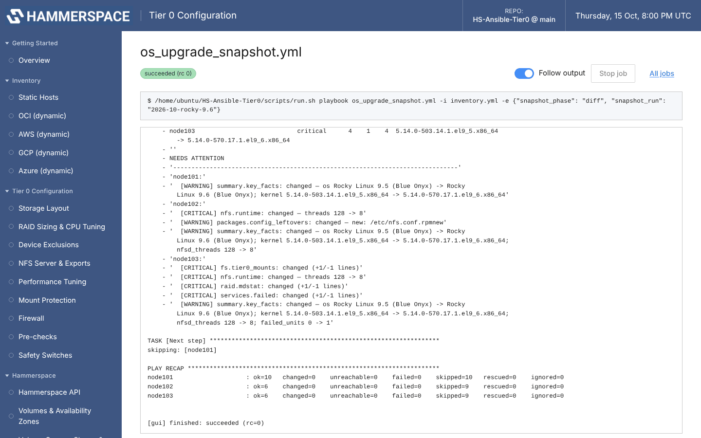

**Hammerspace Utilities** has a form for each cluster-side tool
(`cleanup_instance_nodes.py`, `set_availability_drop.py`,
`set_volume_thresholds.py`, `add_volumes_to_group.py`,
`assign_az_to_volumes.py`, `rename_oci_instances_az.py`). The Anvil host and
user are pre-filled from `vars/main.yml`. **Dry run is on by default**; a real
run requires confirmation and passes `--yes` (the scripts' interactive prompt
has no terminal here). The Hammerspace password is given as a password file or
passed through the `HAMMERSPACE_PASSWORD` environment variable — never on the
command line.


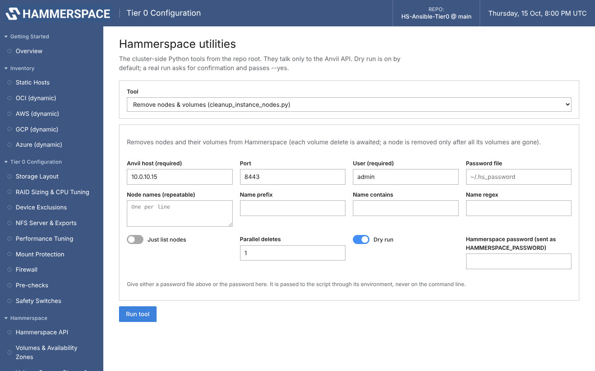

## OS Upgrade Check

A guided page for [`os_upgrade_snapshot.yml`](../docs/os-upgrade-check.md):

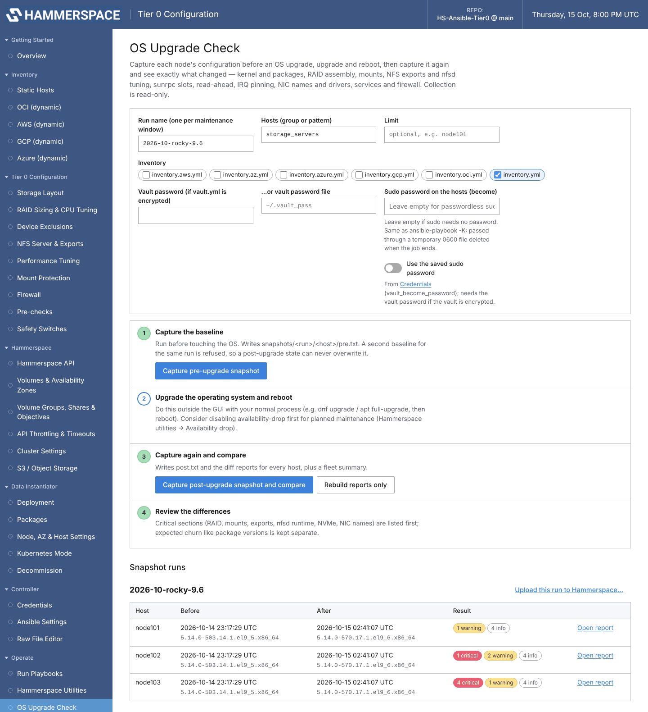


1. **Capture the baseline** before touching the OS (`pre`).
2. **Upgrade and reboot** with your normal process.
3. **Capture again and compare** (`post`) — writes the per-host reports and
   the fleet summary.
4. **Review**: each host shows critical / warning / info counts; *Open report*
   renders the diff in the GUI — what needs attention, headline values before
   and after, changed sections (critical ones expanded), packages as an
   upgraded/removed table, sysctl and nfsd values as before → after.

*Compare two other captures of this host* diffs any two archived captures,
e.g. the baseline against a second post-upgrade capture taken after you fixed
something. The HTML / text reports and the raw snapshots open in a new tab.

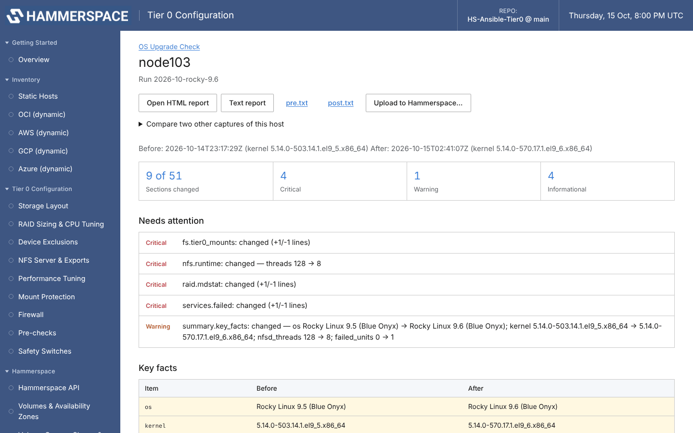

## Logs & Reports

Every Ansible action is logged and kept on the controller, under `logs/` in the
repository (gitignored):

| What | Where | Written by |
|------|-------|------------|
| One Ansible log per run | `logs/ansible-<time>-<cmd>-<playbook>-<pid>.log` | `scripts/run.sh` (header: who, where, the command with secrets masked) |
| One Ansible log per GUI run | `logs/ansible-<time>-gui-<playbook>-<id>.log` | the GUI, linked to its job |
| Runs that bypass `run.sh` | `logs/ansible.log` | `ansible.cfg` `log_path` (catch-all, rotated at 20 MB) |
| GUI job output | `logs/gui-jobs/<id>.log` + `.json` | the GUI |
| GUI audit trail | `logs/gui-audit.log` | the GUI: saves, vault encrypt, job start/finish, settings, start-up (JSON lines; rotated at 20 MB) |
| Upload manifests / kept bundles | `logs/uploads/` | `scripts/hs_upload.py` |
| Reports | `snapshots/`, `preflight_report.txt`, `instance_report.csv`, `gpu_fabric_data.txt`, `.new_instances_limit` | playbooks and tools |

Older logs written by `run.sh` to `~/logs/` are listed too. GUI job history from
before this version (`.gui-jobs/`) is moved to `logs/gui-jobs/` on first start.

**Operate → Logs & Reports** lists all of it, newest first, with a filter by
kind and a search box. *View* opens a log at its end; *Load earlier* / *Load
more* page through files of any size, and the line filter narrows what is
shown. Each Ansible log links to the GUI job that ran it and back. The
*Activity* tab shows the audit trail.

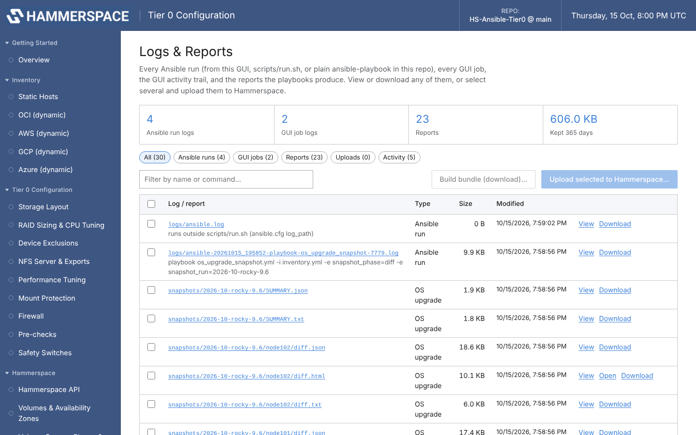

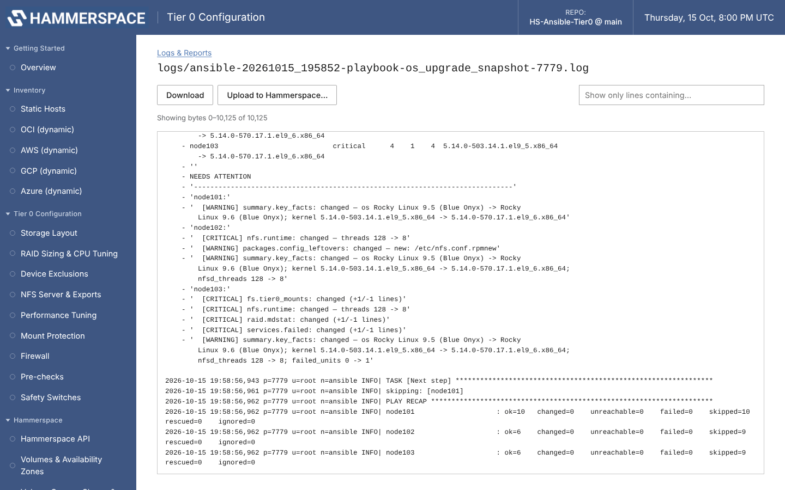

**Retention.** Logs older than the retention period (default **365 days**;
`0` keeps everything) are deleted every 6 hours and when you press *Apply
retention now*. Reports, the live `ansible.log` / `gui-audit.log` and the logs
of running jobs are never deleted. Settings are stored in `.gui-state.json`.

### Uploading to Hammerspace

Tick any logs or reports and press **Upload to Hammerspace…** (the same button is
on a finished job, on an OS Upgrade Check report and on each upgrade run). It
runs [`scripts/hs_upload.py`](../scripts/hs_upload.py), which uses the same
intake as `HS_PS_Toolkit.sh`:

```
POST https://v1proto.sc.hammerspace.com/upload/   (multipart/form-data)
  payload=prosvcs  cluster_id=manual  payload_type=prosvcs  file=@<bundle>.tar.gz
```

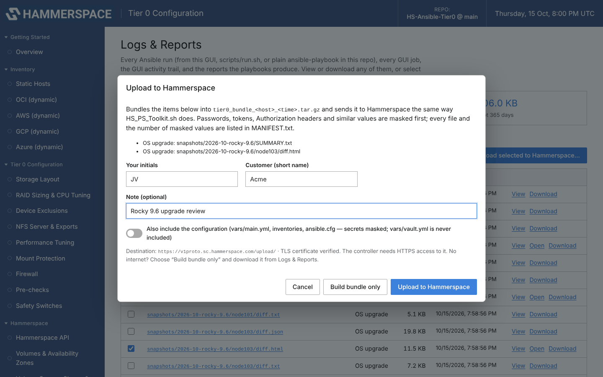

- The bundle is `tier0_bundle_<host>_<YYYYmmdd_HHMMSS>.tar.gz`; its top folder is
  `<INITIALS>-<CUSTOMER>-tier0_<host>_<time>` when initials and customer are
  given (remembered for next time), plus a `MANIFEST.txt` (host, git commit,
  note, and a sha256 per file).
- *Include configuration* adds `vars/main.yml`, `ansible.cfg` and the
  inventories. **`vars/vault.yml`, vault password files and SSH keys are never
  included**, whatever you select.
- Passwords, tokens, keys, `Authorization` headers and `user:password@` in URLs
  are masked (`********`) in every text file before it is bundled; the manifest
  records how many values were masked.
- On success the bundle is deleted and its manifest kept in `logs/uploads/`. On
  failure the bundle is kept there so you can retry or send it another way.
  *Build bundle only* skips the upload.
- TLS is verified by default. The toolkit uses `curl --insecure`; tick *Don't
  verify TLS* in Settings if your controller can't verify the intake's
  certificate. The URL can be changed in Settings (or `TIER0_UPLOAD_URL`).

From a shell:

```bash
python3 scripts/hs_upload.py --initials JV --customer Acme --note "case 1234" \
    logs/ansible-20261015_101500-playbook-site-12345.log snapshots/20261015-1015
python3 scripts/hs_upload.py --bundle-only --include-config logs/   # build, don't send
```

## Security model

The GUI can edit configuration and run playbooks as the user who started it,
so it is locked down by default:

- Binds to `127.0.0.1`; reach it through an SSH tunnel.
- Every API request needs the random per-start token from the printed URL
  (constant-time comparison). The page keeps it in session storage and sends
  it as a request header; the start-up URL carries it in the fragment, which
  browsers never send over the network. Report links that open in a new tab
  pass it as a query parameter to the local server only, and every response
  sets `Referrer-Policy: no-referrer`.
- State-changing requests must carry a custom header, which a cross-site page
  cannot send without a CORS preflight — this blocks CSRF.
- Only allow-listed configuration files can be read or written, and paths
  cannot escape the repository.
- Only catalogued playbooks, tags, inventories and scripts can be run. Every
  command is built as an argument list and executed without a shell, so form
  input cannot inject commands. Limits and option values starting with `-` are
  rejected.
- Secrets are never placed on a command line or written in plaintext.
- Strict Content-Security-Policy; page content from files and logs is always
  inserted as text, never as HTML.
- Logs and reports are served only from `logs/`, `snapshots/` and the named report
  files, by id, after a path check — never arbitrary files. Documentation
  screenshots are served only from `docs/images/` (PNG, JPEG, GIF, WebP; no SVG).
- Every change and run is recorded in `logs/gui-audit.log` (who, from where, what).
- `--read-only` disables every write and run.

## Troubleshooting

| Symptom | Fix |
|---------|-----|
| "Sign-in link needed" | Open the full URL printed at start-up, including `#token=…`. The token changes on every start unless you pass `--token`. |
| `cannot listen on 127.0.0.1:8765` | Another instance (or app) has the port — use `--port`. |
| `PyYAML is required` | `pip3 install pyyaml`, or run with the Python that has Ansible. |
| Save refused: "changed on disk" | Someone edited the file after you loaded it. Reload the page; your unsaved edits on that menu are discarded. |
| Save refused: "edit rejected, nothing was written" | The edit didn't verify (e.g. the key appears twice in the file). Fix the file in the Raw File Editor. |
| "the vault password is incorrect" | Re-enter it; the vault was encrypted with a different password. |
| Playbook job fails immediately | Check the first lines of the job log — usually a missing collection (`ansible-galaxy collection install -r requirements.yml`) or an unreadable inventory. |
| Old backups / job logs piling up | `.gui-backups/` keeps 30 per file; logs follow the retention period in Logs & Reports → Settings (both are gitignored). |
| Upload fails: certificate verify failed | The controller doesn't trust the intake's certificate. Tick *Don't verify TLS* in Logs & Reports → Settings, or install the CA. The bundle is kept in `logs/uploads/`. |
| Upload fails: cannot reach the server | No route or proxy to the intake. Set `HTTPS_PROXY` before starting the GUI, or use *Build bundle only* and send the file another way. |

## Adding a variable to the GUI

Fields are data, not code. When you add a variable to `vars/main.yml`, add
one entry to the relevant section in [`schema.py`](schema.py):

```python
F("perf_example_knob", "int", "Example knob",
  "What it does and when to change it.", default=42, optional=True,
  show_if={"perf_tuning_enabled": True}),
```

Types: `bool`, `int`, `float`, `str`, `secret`, `enum` (with `options`),
`list` (one string per line), `intlist`, `yaml` (lists of dicts / maps, with an
optional `example`). `tests/integration/test_gui_and_snapshot.py` fails if a
top-level key of `vars/main.yml` has no field, so the GUI can't silently fall
behind the playbooks.

To offer a new playbook or tool on the Operate pages, add it to
[`catalog.py`](catalog.py) with its tags and options.

| File | Role |
|------|------|
| `tier0_gui.py` | HTTP server, validation, vault handling, inventory model, upgrade report API |
| `schema.py` | Menus and fields |
| `surgeon.py` | Comment-preserving YAML / INI editing and verification |
| `catalog.py` | Allowed playbooks / scripts and their argv builders |
| `jobs.py` | Background job runner |
| `static/` | Single-page front end (`index.html`, `app.js`, `style.css`) |
